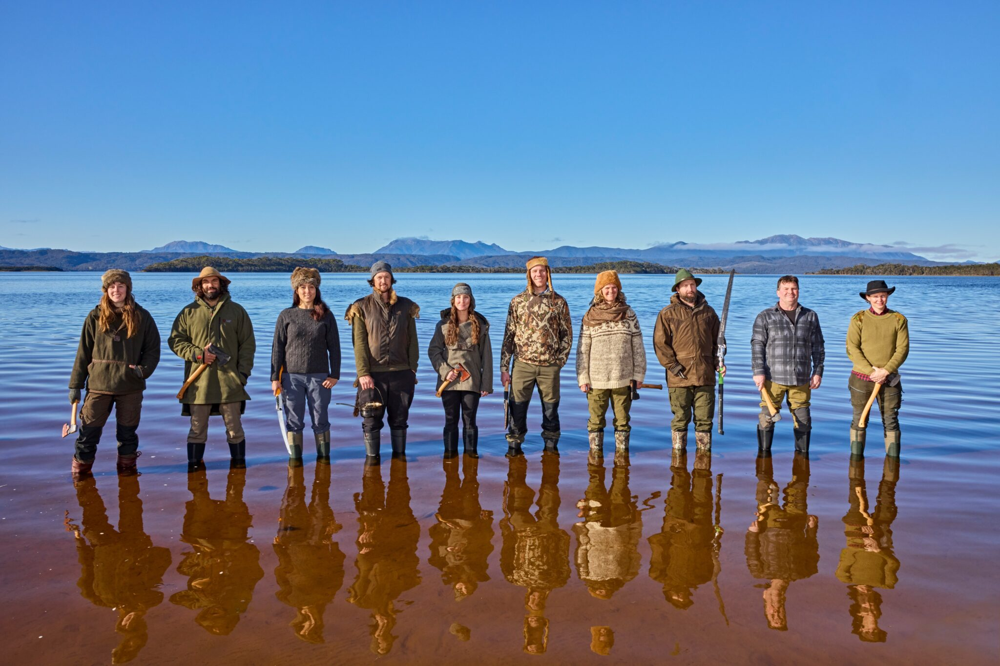
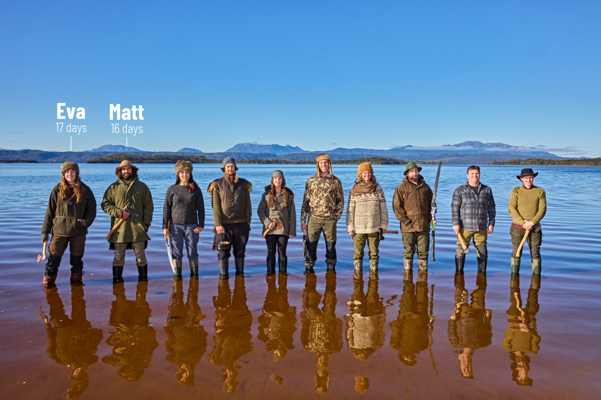
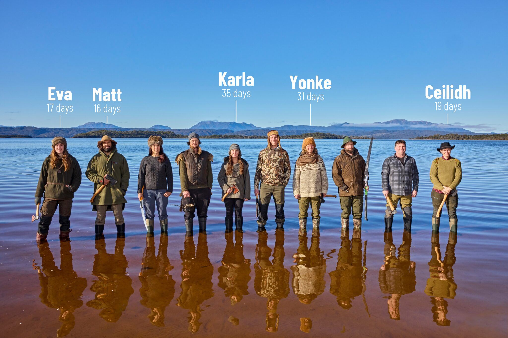
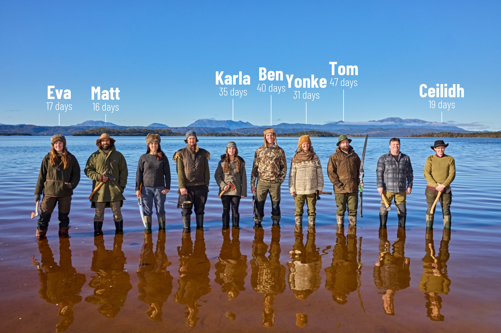
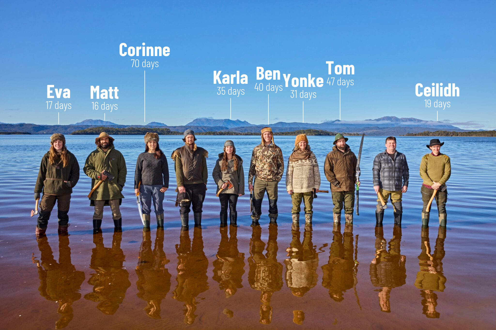
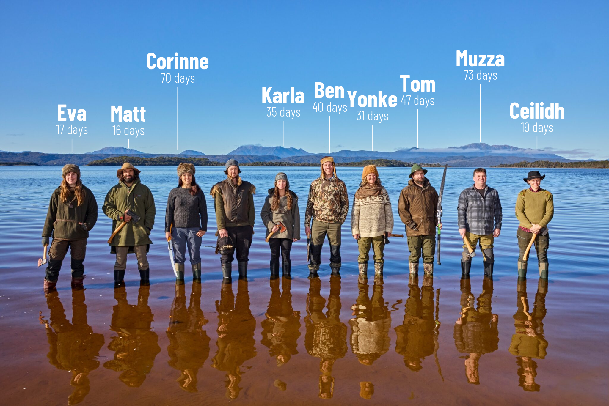
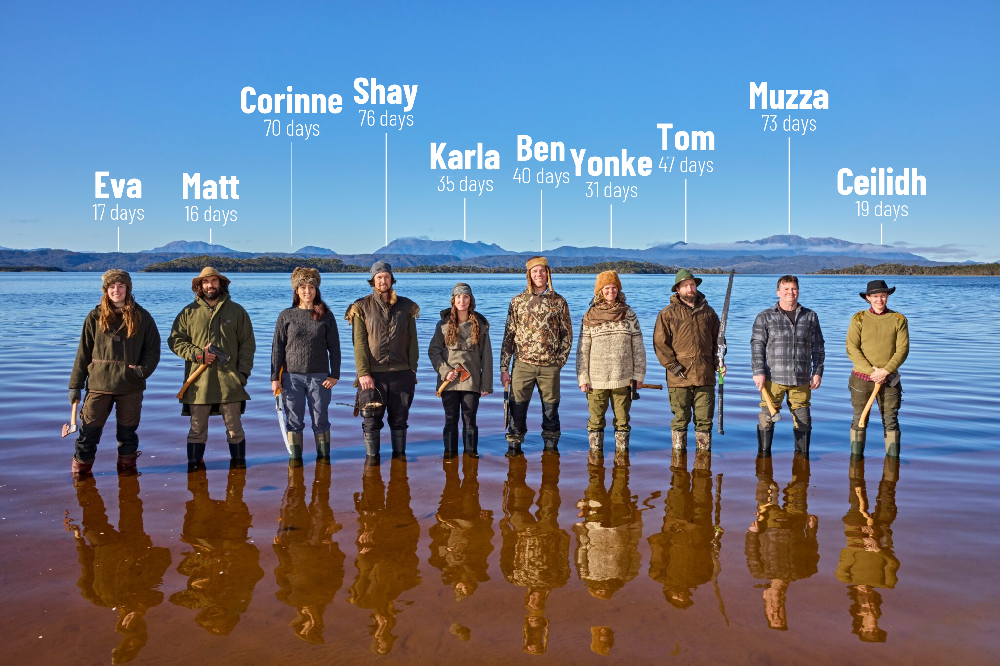

::::{.cr-section}

:::{#cr-cast-0}

:::

In the third season of Alone Australia, ten survivalists 
were abandoned in the remote and unforgiving wilderness 
of Tasmania's West Coast Ranges. @cr-cast-0

The diverse group of contestants, which for the first time 
included an equal number of men and women.

They had to rely on their unique skills, ranging from traditional 
Indigenous knowledge and professional trapping 
to bushcraft and foraging. 

As they battled relentless rain, plunging temperatures, each 
participant was forced to dig deep, pushing their physical 
and mental limits. 

Here's how the season shaped up @cr-cast-0

:::{#cr-cast-1}

:::

Matt was the first to tap at a 
respectable 16 days @cr-cast-1

The second longest first tap out of the 
Australian and US series

The longest is 18 days - Lee in season 10

Matt tapped because he missed his family

:::{#cr-cast-2}

:::

Eva was the second person to tap at 17 days @cr-cast-2

She tapped due to not being able to procure food,
felt like she exhausted all options fishing

:::{#cr-cast-3}

:::

__Ceilidh__ was 3rd to tap at day 19 @cr-cast-3

She tapped due to health reasons - Likely kidney 
infection from an untreated UTI

:::{#cr-cast-4}

:::

__Yonke__ was 4th to tap at day 31 @cr-cast-4

She tapped for personal reasons and not 
getting the experience she hoped for

:::{#cr-cast-5}

:::

__Karla__ was the 5th tap at day 35 @cr-cast-5

She tapped for personal reasons, ultimately
missing her friends and family

:::{#cr-cast-6}

:::

__Ben__ was medically pulled at day 40 @cr-cast-6

Nothing was going to get Ben to tap, instead he
was pulled during a medical check for starvation
and low blood pressure

:::{#cr-cast-7}

:::

__Tom__ tapped out on day 47 @cr-cast-7

He couldn't procure enough food, didn't want 
to wait for medical to extract him

:::{#cr-cast-8}

:::

__Corinne__ tapped out on day 70 @cr-cast-8

She decided she didn't have anything more to prove
and ended her journey

:::{#cr-cast-9}

:::

__Muzza__ was pulled from the game on day 73 @cr-cast-9

The bushman was eating well but not quite enough
and the medical team extracted him due to low blood pressure

:::{#cr-cast-10}

:::

And the winner for the season is __Shay__ who
survived 76 days in the brutal Tassie environment @cr-cast-10

:::{#cr-au-top10}
| 01. Shay - 76 days 
| 02. Muzza - 73 days 
| 03. Corinne - 70 days 
| 04. Gina Chick - 67 days 
| 05. Mike Atkinson - 64 days 
| 06. Krzysztof - 64 days 
| 07. Suzan - 63 days 
| 08. Andreas - 57 days 
| 09. Tamika - 53 days 
| 10. Tom - 47 days 
:::

Here is the top 10 players that survived the longest
in Alone Australia @cr-au-top10

__Shay__ survived longer than any other winner
in Alone Australia [@cr-au-top10]{highlight="1"}

__Shay__, __Muzza__, and __Corinne__ are the top 
three [@cr-au-top10]{highlight="1-3"}

:::{#cr-au-us-top20}
| 01.	Roland Welker (S7) - 100 days 
| 02.	Callie Russell (S7) - 89 days 
| 03.	Zachary Fowler (S3) - 87 days 
| 04.	Carleigh Fairchild (S3) - 86 days 
| 05.	William Larkham Jr. (S11) - 84 days 
| 06.	Timber Cleghorn (S11) - 83 days 
| 07.	Kielyn Marrone (S7) - 80 days 
| 07.	Dub Paetz (S11) - 80 days 
| 09.	Megan Hanacek (S3) - 78 days 
| 09.	Juan Pablo Quinonez (S9) - 78 days 
| 11.	Jordan Jonas (S6) - 77 days 
| 12.	Shay (S3) - 76 days 
| 13.	Jim Baird (S4) - 75 days 
| 13.	Ted Baird (S4) - 75 days 
| 13.	Karie Lee Knoke (S9) - 75 days 
| 16.	Pete Brockdorff (S4) - 74 days 
| 16.	Sam Brockdorff (S4) - 74 days 
| 16.	Clay Hayes (S8) - 74 days 
| 19.	Dave Nessia (S3) - 73 days 
| 19.	Woniya Thibeault (S6) - 73 days 
| 19.	Biko Wright (S8) - 73 days 
| 19.	Muzza (S3) - 73 days 
:::

Here are those in the top 20 out of 144 players from
11 US seasons and 3 AU seasons @cr-au-us-top20

__Shay__ sits in 12th place [@cr-au-us-top20]{highlight="12"}

__Muzza__ sits in equal 19th place [@cr-au-us-top20]{highlight="22"}

:::{#cr-follow}

<i class="fa-brands fa-bluesky"></i>&nbsp;@danoehm</a>

:::

Follow me on [Bluesky](https://bsky.app/profile/danoehm.bsky.social)&nbsp;<i class="fa-brands fa-bluesky"></i> @cr-follow

::::
